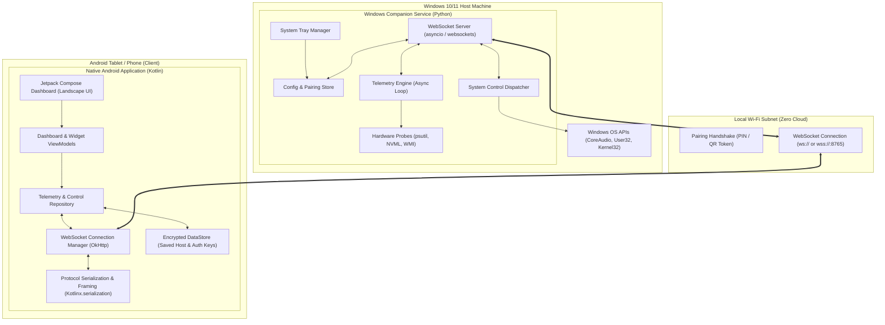
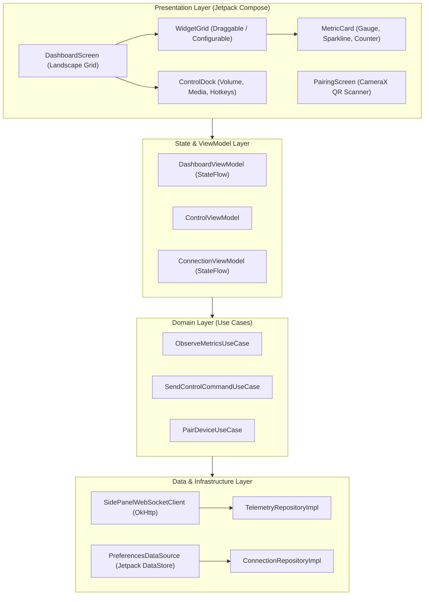
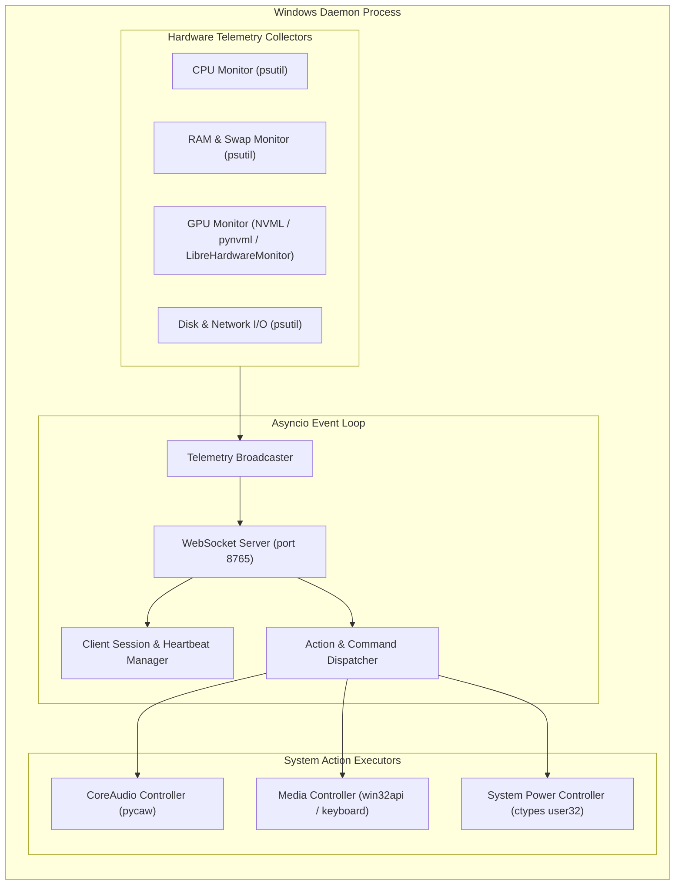
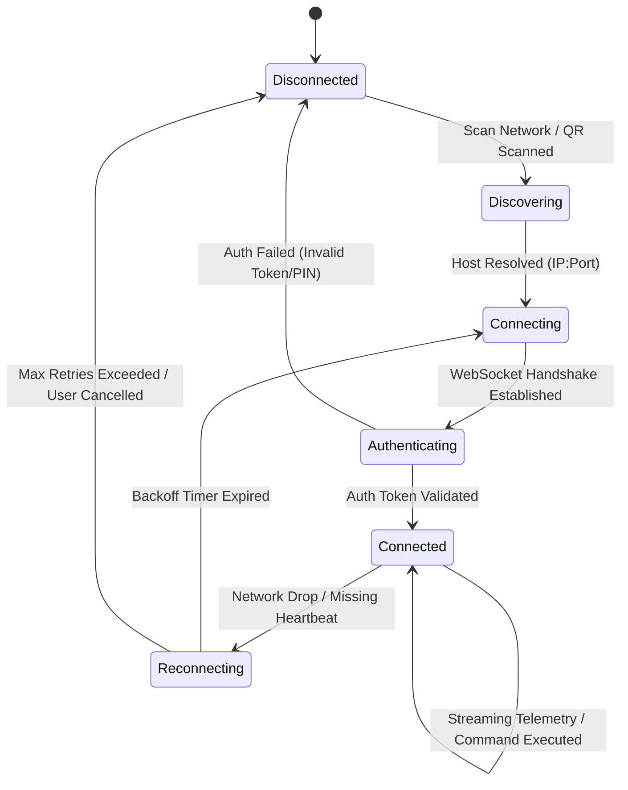

# SidePanel: System Architecture (ARCHITECTURE.md)

This document describes the end-to-end architectural design for the SidePanel project, spanning the Native Android Client, the Windows Companion Service, and their local networking subsystem.

---

## 1. High-Level Architecture & Network Topology

SidePanel operates on a peer-to-peer client-server topology restricted to the user's Local Area Network (LAN):

---

## 2. Android Client Architecture

The Android application is structured following modern Google-recommended Android Architecture principles (Clean Architecture + Unidirectional Data Flow / MVI).

### 2.1. Key Android Technologies
- **UI Toolkit**: Jetpack Compose 1.7+ (Material3, Canvas for low-overhead hardware graphs).
- **Architecture**: Single-Activity, Compose Navigation, MVVM / MVI with `StateFlow` and `SharedFlow`.
- **Concurrency**: Kotlin Coroutines (`Dispatchers.IO`, `Dispatchers.Default`, `Dispatchers.Main`).
- **Networking**: OkHttp 4.12+ WebSocket engine with automated exponential backoff and custom ping/pong keep-alives.
- **Serialization**: `kotlinx.serialization.json` (efficient, type-safe, reflection-free JSON parsing).
- **Local Persistence**: Jetpack DataStore (saving paired hosts, tokens, widget configurations).
- **Camera/Scanner**: CameraX + Google ML Kit Barcode Scanning (for zero-friction QR pairing).

---

## 3. Windows Companion Architecture

The Windows application is an asynchronous event-driven daemon designed to run quietly in the system tray.

### 3.1. Key Windows Technologies
- **Language**: Python 3.10+ (using `asyncio`).
- **Networking / Server**: `websockets` (RFC 6455 compliant, asynchronous Python WebSocket server).
- **Hardware Telemetry**:
  - `psutil` (Cross-platform system utilization, memory, disks, network rates).
  - `pynvml` (NVIDIA Management Library for discrete GPU usage, VRAM, and thermal monitoring).
  - WMI / LibreHardwareMonitor CLI/DLL wrapper (AMD & Intel thermal/clock telemetry).
- **System Automation**:
  - `pycaw` (Python Core Audio Windows Library for volume and mute control).
  - `ctypes` / `win32api` for media key injection, desktop locking, and monitor power management.
- **System Tray**:
  - `pystray` + `Pillow` for responsive Windows taskbar tray icon, context menus, and visual status.

---

## 4. Connection Lifecycle & State Machine

### 4.1. Lifecycle Details
1. **Discovery / Configuration**: Android client learns Windows companion IP and Port either via QR code scan (generated by Windows tray) or manual IP configuration.
2. **WebSocket Handshake**: TCP connection and WebSocket upgrade request on port 8765.
3. **Authentication Phase**: First packet from client must be an `AUTH_REQUEST` with the pairing token. If valid within 3 seconds, host responds with `AUTH_SUCCESS`; otherwise connection is severed.
4. **Active Streaming**: Host continuously pushes `METRICS_STREAM` packets at the configured interval (e.g., 1000ms). Client pushes `COMMAND_EXECUTE` messages as interactive user events occur.
5. **Heartbeat Maintenance**: Ping-pong frames or application-level keep-alives every 5 seconds. If no response is received within 10 seconds, client transitions to `Reconnecting`.

---

## 5. Security Architecture

1. **Local Subnet Isolation**: The companion server binds to local IPv4 network interfaces (or optionally loopback during testing). No port forwarding (UPnP/NAT) is ever configured.
2. **Mutual Pairing Token**:
   - On first setup, the Windows companion generates a cryptographically random pairing token (or 6-digit PIN).
   - Displayed as a QR code in the Windows tray app.
   - Android client scans the QR code and stores the token securely in encrypted local storage.
3. **Replay & DoS Protection**:
   - Connection attempts from unauthorized IPs are throttled (rate-limited).
   - Maximum of 3 simultaneous client connections allowed.
4. **Command Whitelist Validation**:
   - Commands are strictly enumerated enums (e.g., `VOLUME_SET`, `MEDIA_PLAY_PAUSE`, `LOCK_WORKSTATION`).
   - Arbitrary shell script execution is structurally impossible by design.
