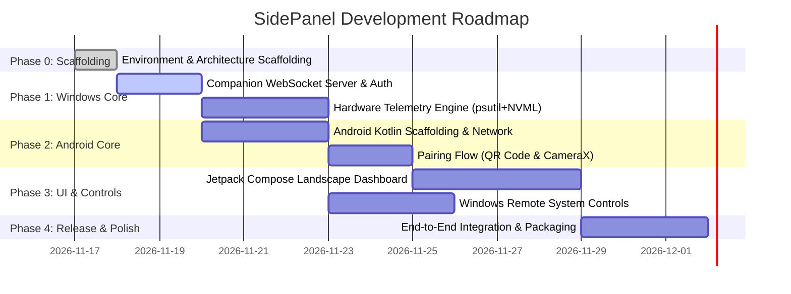

# SidePanel: Master Development Plan (DEVELOPMENT_PLAN.md)

This document establishes the roadmap, task breakdown, testing criteria, and milestone dependencies for developing the SidePanel system.

---

## 1. Roadmap Overview & Timeline

---

## 2. Milestone Breakdown

### Milestone 0: Environment Inspection, Architecture & Scaffolding *(Current Milestone)*
- **Objective**: Validate development toolchains, establish repository structure, formalize architecture, communication protocol, and initialize version control.
- **Tasks**:
  - [x] Inspect toolchain: JDK 17, Android Studio 2026.2.2, Android SDK, Python 3.14, Git.
  - [x] Scaffolding directory tree for Android and Windows.
  - [x] Author `PROJECT_SPEC.md`, `ARCHITECTURE.md`, `PROTOCOL.md`, and `DEVELOPMENT_PLAN.md`.
  - [x] Author root `.gitignore` and `README.md`.
  - [x] Initialise Git repository.
- **Verification**: Zero compile errors, clean repository status, documentation complete.

---

### Milestone 1: Windows Companion WebSocket Server & Authentication Core *(Completed)*
- **Objective**: Build the foundational Python daemon capable of hosting an authenticated RFC 6455 WebSocket server conforming to `PROTOCOL.md`.
- **Tasks**:
  - [x] Set up Python virtual environment (`windows/.venv`).
  - [x] Implement `windows/src/core/config.py` for token generation, local persistence, and settings.
  - [x] Implement `windows/src/server/protocol.py` defining envelope validation and serialization.
  - [x] Implement `windows/src/server/ws_server.py` using `asyncio` and `websockets`.
  - [x] Implement authentication handshake (`AUTH_REQUEST` / `AUTH_RESPONSE`) with token verification.
  - [x] Implement ping/pong keep-alive handler.
  - [x] Implement mock telemetry broadcaster to enable Android client testing ahead of hardware probes.
  - [x] Write and verify comprehensive automated test suite (`pytest`).
- **Deliverables**:
  - Working, testable Python WebSocket server on `0.0.0.0:8765`.
  - Automated tests verifying handshake, invalid token rejection, rate limiting, and ping-pong timeouts (15/15 passing).
- **Exit Criteria**: Test client connects, authenticates with valid token, receives mock stream, and rejects unauthorized connections. (Verified)

---

### Milestone 2: Windows Hardware Telemetry Engine *(Completed)*
- **Objective**: Implement low-overhead, accurate sensor data collectors for CPU, GPU, RAM, Disk, and Network.
- **Tasks**:
  - [x] Implement `windows/src/hardware/cpu.py` (`psutil` overall %, per-core %, frequency, temperature).
  - [x] Implement `windows/src/hardware/ram.py` (Used, free, percentage, swap/pagefile).
  - [x] Implement `windows/src/hardware/gpu.py` (`pynvml` for NVIDIA GPU utilization, VRAM, temp, fan; fallback for non-NVIDIA).
  - [x] Implement `windows/src/hardware/io.py` (Disk read/write MB/s, Network upload/download rate calculation).
  - [x] Implement `windows/src/hardware/aggregator.py` which unifies metrics into a `METRICS_STREAM` payload.
  - [x] Profile CPU utilization and verify real hardware telemetry streaming over WebSocket.
  - [x] Add automated hardware collector test suite (20/20 passing).
- **Deliverables**:
  - Real-time hardware telemetry pipeline streaming live PC stats over WebSocket.
- **Exit Criteria**: Accurate metric values verified against live system (NVIDIA RTX 3060, 12-core CPU, RAM, Disk, Network). (Verified)

---

### Milestone 3: Android Scaffolding & Network Core
- **Objective**: Create the native Android Gradle project in Kotlin and implement the background WebSocket networking engine.
- **Tasks**:
  - [ ] Scaffolding native Android Studio project (`android/`) targeting SDK 35/36 with Compose BOM.
  - [ ] Add dependencies: OkHttp, Kotlinx Serialization, Jetpack DataStore, Coroutines.
  - [ ] Implement `data/protocol` models matching `PROTOCOL.md`.
  - [ ] Implement `data/network/SidePanelWebSocketClient.kt` with OkHttp.
  - [ ] Implement auto-reconnection state machine with exponential backoff.
  - [ ] Implement `data/repository/TelemetryRepository.kt` exposing `Flow<TelemetryData>`.
- **Deliverables**:
  - Android application connecting to Windows companion and printing received telemetry to Logcat.
- **Exit Criteria**: Stable connection that recovers cleanly after Wi-Fi toggling or server restart.

---

### Milestone 4: Pairing Experience (QR Code & Discovery)
- **Objective**: Enable zero-configuration, seamless pairing between Android and PC.
- **Tasks**:
  - [ ] Windows: Generate unique 32-character pairing token and display QR code containing `sidepanel://<IP>:<PORT>?token=<TOKEN>`.
  - [ ] Android: Integrate CameraX and ML Kit Barcode Scanning for instant QR code capture.
  - [ ] Android: Store paired host IP and token securely in Jetpack DataStore.
  - [ ] Provide manual IP/Port fallback dialog.
- **Deliverables**:
  - Functional pairing flow requiring under 5 seconds from app launch to connected state.
- **Exit Criteria**: Fresh Android install connects to PC solely by scanning the QR code on screen.

---

### Milestone 5: Android Jetpack Compose Dashboard UI
- **Objective**: Design and build the landscape-first, hardware-accelerated dashboard interface.
- **Tasks**:
  - [ ] Lock activity to Landscape orientation with immersive sticky mode (`WindowInsetsControllerCompat`).
  - [ ] Design and implement responsive grid layout (`LazyVerticalGrid` or custom grid layout).
  - [ ] Implement **CPU Widget** (Radial utilization gauge, per-core bar chart, thermal badge).
  - [ ] Implement **GPU Widget** (Core clock, VRAM gauge, temperature indicator).
  - [ ] Implement **Memory & Storage Widget** (RAM usage ring, Disk I/O activity sparks).
  - [ ] Implement **Network Widget** (Real-time speed graph / Canvas sparkline).
  - [ ] Implement Connection Status bar (Host name, latency ping in ms, reconnecting banner).
- **Deliverables**:
  - Complete, fluid 60fps+ landscape dashboard UI displaying live metrics.
- **Exit Criteria**: Smooth animations, no UI stuttering, readable layout across 7" to 12" screen sizes.

---

### Milestone 6: Windows Remote System Controls
- **Objective**: Enable two-way interactivity, allowing the Android client to trigger Windows actions.
- **Tasks**:
  - [ ] Windows: Implement `windows/src/controls/audio.py` using `pycaw` (Volume slider, mute).
  - [ ] Windows: Implement `windows/src/controls/media.py` using Win32 API (Play/pause, next, prev).
  - [ ] Windows: Implement `windows/src/controls/power.py` (Workstation lock, display sleep).
  - [ ] Android: Implement Control Dock widget in Compose (Volume slider, media buttons, action tiles).
  - [ ] Implement command acknowledgment and error feedback toast.
- **Deliverables**:
  - Interactive control bar on Android executing real-time changes on Windows PC.
- **Exit Criteria**: Adjusting volume slider on tablet adjusts Windows master volume within 50ms.

---

### Milestone 7: Optimization, Polish & Standalone Packaging
- **Objective**: Prepare production-grade release builds for both platforms.
- **Tasks**:
  - [ ] Windows: Implement system tray icon (`pystray`) with context menu (Open QR, Pause, Settings, Exit).
  - [ ] Windows: Package using PyInstaller into a standalone `.exe` without requiring Python pre-installed.
  - [ ] Windows: Add optional "Start with Windows" registry helper.
  - [ ] Android: Add Keep-Screen-On toggle, dark/OLED theme optimization, ProGuard/R8 optimization.
  - [ ] End-to-end stress testing (24-hour continuous stream test).
- **Deliverables**:
  - Release APK for Android.
  - Standalone Windows installer or portable executable.

---

## 3. Risk Matrix & Mitigations

| Risk | Impact | Probability | Mitigation Strategy |
| :--- | :--- | :--- | :--- |
| **Windows Defender Firewall blocks incoming port 8765** | High | High | Companion will include a setup script / helper to automatically create an inbound Windows Firewall rule for the app binary. |
| **Non-NVIDIA GPUs (AMD/Intel) lack NVML API** | Medium | Medium | Telemetry engine will feature graceful fallbacks: NVML first, followed by WMI / Windows Performance Counters. |
| **Android OS battery optimization kills background socket** | Medium | High | Application is foreground-primary (dashboard kept on screen), utilizing `FLAG_KEEP_SCREEN_ON` and foreground connection management. |
| **High Wi-Fi latency or packet jitter** | Medium | Low | Low-overhead JSON envelopes, batch metrics into single broadcast frame, configurable throttle (500ms-2000ms). |
