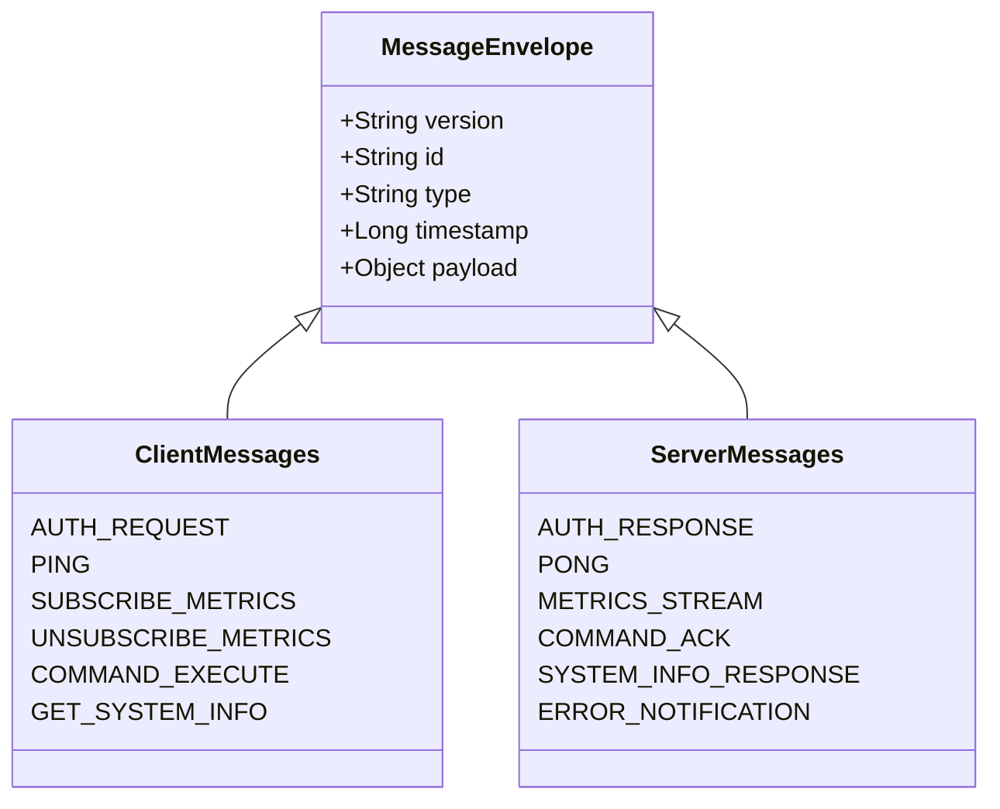
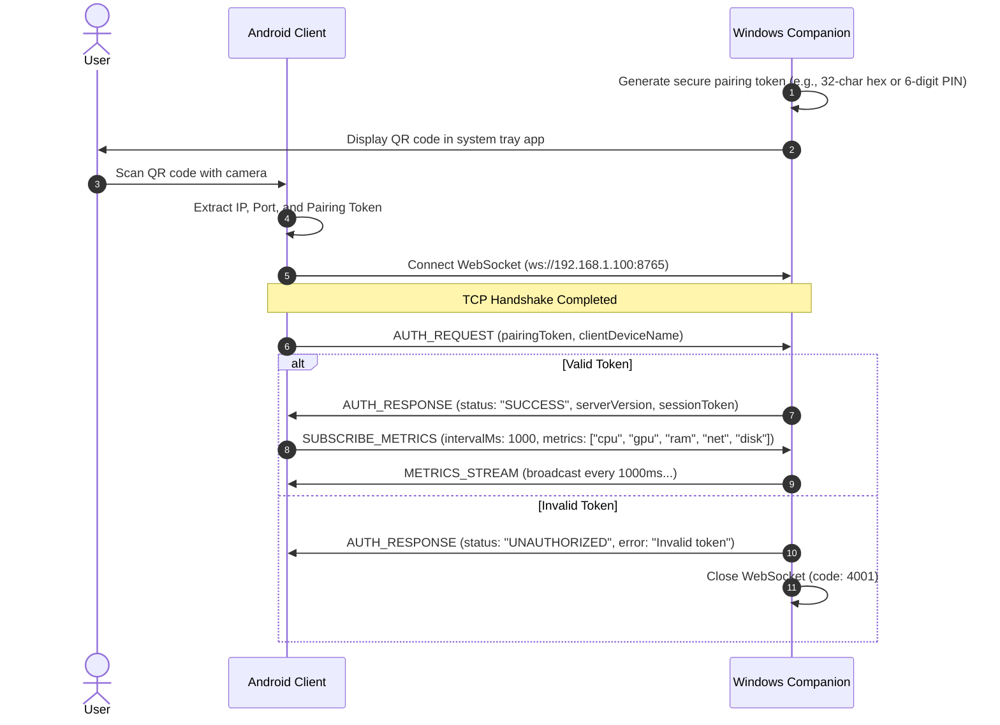

# SidePanel: Communication Protocol Specification (PROTOCOL.md)

| Field | Specification |
| :--- | :--- |
| **Protocol Name** | SidePanel Local Wire Protocol (SPLWP) |
| **Protocol Version** | `1.0` |
| **Transport** | WebSocket over TCP (RFC 6455) |
| **Default Port** | `8765` |
| **Data Encoding** | JSON (UTF-8 encoded text frames) |

---

## 1. Message Envelope Architecture

Every message transmitted over the WebSocket connection (both Client-to-Server and Server-to-Client) must conform to the standard top-level JSON envelope:

```json
{
  "version": "1.0",
  "id": "uuid-v4-or-sequential-id",
  "type": "MESSAGE_TYPE",
  "timestamp": 1731864000123,
  "payload": {}
}
```

### Top-Level Fields

| Field | Type | Required | Description |
| :--- | :--- | :--- | :--- |
| `version` | string | Yes | Protocol version string (e.g. `"1.0"`). Must match between host and client. |
| `id` | string | Yes | Unique identifier for message tracking, correlation, and acknowledgments. |
| `type` | string | Yes | Standardized message type enum (see Section 2). |
| `timestamp` | integer | Yes | Milliseconds since Unix epoch (`System.currentTimeMillis()` / `time.time() * 1000`). |
| `payload` | object | Yes | Specific data payload corresponding to the message `type`. |

---

## 2. Standard Message Types



---

## 3. Pairing & Authentication Flow



### 3.1. `AUTH_REQUEST` (Client -> Server)
Sent immediately upon WebSocket connection. Must be received within 3000ms of socket open.

```json
{
  "version": "1.0",
  "id": "req-auth-001",
  "type": "AUTH_REQUEST",
  "timestamp": 1731864000100,
  "payload": {
    "token": "a4f89b6c12e84d7a9b0c2d3e4f5a6b7c",
    "deviceName": "Samsung Galaxy Tab S8",
    "clientVersion": "1.0.0"
  }
}
```

### 3.2. `AUTH_RESPONSE` (Server -> Client)

```json
{
  "version": "1.0",
  "id": "resp-auth-001",
  "type": "AUTH_RESPONSE",
  "timestamp": 1731864000150,
  "payload": {
    "status": "SUCCESS",
    "serverName": "DESKTOP-RYZEN9",
    "serverVersion": "1.0.0",
    "sessionToken": "sess-98a76d5e-4321-bfed-0987654321ab",
    "capabilities": {
      "hasNvidiaGpu": true,
      "audioControl": true,
      "mediaControl": true,
      "supportedIntervalsMs": [250, 500, 1000, 2000, 5000]
    }
  }
}
```

---

## 4. Heartbeat (Ping / Pong)

To detect half-open sockets and dropped Wi-Fi connections, heartbeat messages are exchanged periodically.

### 4.1. `PING` (Client -> Server)
Transmitted by the client every 5000ms if no other traffic was sent.

```json
{
  "version": "1.0",
  "id": "ping-101",
  "type": "PING",
  "timestamp": 1731864005000,
  "payload": {}
}
```

### 4.2. `PONG` (Server -> Client)

```json
{
  "version": "1.0",
  "id": "pong-101",
  "type": "PONG",
  "timestamp": 1731864005010,
  "payload": {
    "echoTimestamp": 1731864005000
  }
}
```

---

## 5. Telemetry Streaming

### 5.1. `SUBSCRIBE_METRICS` (Client -> Server)
Configures which metric collectors are active and the broadcast rate.

```json
{
  "version": "1.0",
  "id": "sub-001",
  "type": "SUBSCRIBE_METRICS",
  "timestamp": 1731864006000,
  "payload": {
    "intervalMs": 1000,
    "metrics": [
      "cpu",
      "gpu",
      "ram",
      "disk",
      "network",
      "audio"
    ]
  }
}
```

### 5.2. `METRICS_STREAM` (Server -> Client)
Continuously pushed from server to client. Compact, standardized JSON structure.

```json
{
  "version": "1.0",
  "id": "metric-8472",
  "type": "METRICS_STREAM",
  "timestamp": 1731864007000,
  "payload": {
    "cpu": {
      "usagePercent": 24.5,
      "frequencyGhz": 4.25,
      "temperatureC": 58.0,
      "coreCount": 16,
      "perCoreUsage": [22, 31, 15, 18, 45, 12, 10, 8, 20, 25, 30, 40, 15, 12, 18, 20]
    },
    "gpu": {
      "name": "NVIDIA GeForce RTX 4080",
      "usagePercent": 42.0,
      "temperatureC": 61.0,
      "hotspotTempC": 68.5,
      "vramUsedBytes": 6442450944,
      "vramTotalBytes": 17179869184,
      "vramUsagePercent": 37.5,
      "fanSpeedPercent": 45,
      "powerWatts": 165.2
    },
    "ram": {
      "usedBytes": 17179869184,
      "totalBytes": 34359738368,
      "usagePercent": 50.0,
      "availableBytes": 17179869184
    },
    "disk": {
      "readBytesPerSec": 1048576,
      "writeBytesPerSec": 4194304,
      "primaryDrive": {
        "letter": "C:",
        "usedPercent": 64.2,
        "freeBytes": 384829067264
      }
    },
    "network": {
      "downloadBytesPerSec": 2457600,
      "uploadBytesPerSec": 358400,
      "activeInterface": "Ethernet 10Gbps"
    },
    "audio": {
      "masterVolumePercent": 75,
      "isMuted": false,
      "activeOutputDevice": "Headphones (Realtek High Definition Audio)"
    }
  }
}
```

---

## 6. Remote System Controls

Controls are sent by the Android client to trigger actions on the Windows PC.

### 6.1. `COMMAND_EXECUTE` (Client -> Server)

#### Setting Master Volume
```json
{
  "version": "1.0",
  "id": "cmd-vol-01",
  "type": "COMMAND_EXECUTE",
  "timestamp": 1731864010500,
  "payload": {
    "action": "AUDIO_SET_VOLUME",
    "params": {
      "volumePercent": 80
    }
  }
}
```

#### Toggling Mute
```json
{
  "version": "1.0",
  "id": "cmd-mute-02",
  "type": "COMMAND_EXECUTE",
  "timestamp": 1731864011200,
  "payload": {
    "action": "AUDIO_TOGGLE_MUTE",
    "params": {}
  }
}
```

#### Media Play / Pause / Skip
```json
{
  "version": "1.0",
  "id": "cmd-media-03",
  "type": "COMMAND_EXECUTE",
  "timestamp": 1731864012000,
  "payload": {
    "action": "MEDIA_KEY",
    "params": {
      "key": "PLAY_PAUSE"
    }
  }
}
```
*Supported `key` values:* `"PLAY_PAUSE"`, `"NEXT_TRACK"`, `"PREV_TRACK"`, `"STOP"`.

#### System Lock / Display Sleep
```json
{
  "version": "1.0",
  "id": "cmd-sys-04",
  "type": "COMMAND_EXECUTE",
  "timestamp": 1731864015000,
  "payload": {
    "action": "SYSTEM_ACTION",
    "params": {
      "command": "LOCK_WORKSTATION"
    }
  }
}
```
*Supported `command` values:* `"LOCK_WORKSTATION"`, `"DISPLAY_OFF"`.

### 6.2. `COMMAND_ACK` (Server -> Client)

```json
{
  "version": "1.0",
  "id": "ack-cmd-vol-01",
  "type": "COMMAND_ACK",
  "timestamp": 1731864010525,
  "payload": {
    "commandId": "cmd-vol-01",
    "success": true,
    "result": {
      "action": "AUDIO_SET_VOLUME",
      "newVolumePercent": 80
    }
  }
}
```

---

## 7. Error Handling & Standard Error Codes

When a request cannot be satisfied, the server returns an `ERROR_NOTIFICATION` envelope:

```json
{
  "version": "1.0",
  "id": "err-001",
  "type": "ERROR_NOTIFICATION",
  "timestamp": 1731864016000,
  "payload": {
    "code": "UNAUTHORIZED",
    "message": "Authentication token expired or invalid",
    "referenceId": "cmd-vol-01"
  }
}
```

### Standard Error Codes

| Code | HTTP / WS Equivalent | Description | Recommended Action |
| :--- | :--- | :--- | :--- |
| `UNAUTHORIZED` | 4001 | Missing, malformed, or rejected pairing token. | Clear local token and trigger QR re-pair. |
| `INVALID_PAYLOAD` | 4000 | Envelope JSON failed schema validation. | Check client protocol version compatibility. |
| `UNSUPPORTED_ACTION`| 4004 | The requested command action is not implemented or supported on this host. | Disable widget/button on UI. |
| `EXECUTION_FAILED` | 5000 | The Windows OS API returned an error executing the control. | Display transient toast alert. |
| `RATE_LIMITED` | 4029 | Commands arriving faster than permitted threshold (> 20 cmds/sec). | Throttle client UI events. |
| `SERVER_SHUTTING_DOWN` | 1001 | Windows Companion is exiting or user paused streaming. | Transition client to clean Disconnected state. |
